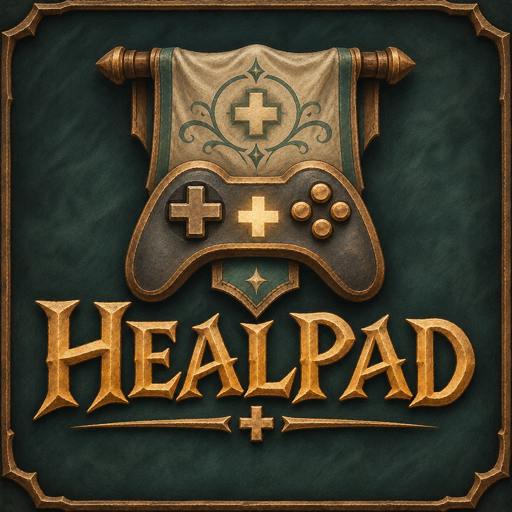
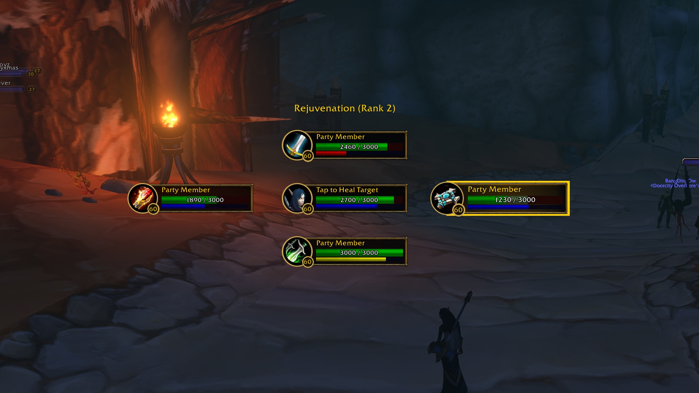

# Healpad

Heal your party without a mouse. Hold a heal button, the party opens around
your character as a diamond, aim, let go.

- **Your buttons**: Healpad reads what you already bound (the game's controller
  setup, the controller bar of the game's Gamepad Mode, or any key). In `/hp`,
  pick a heal and press **Enable**.
- **Hold it**: the diamond opens. Tank up, you in the middle.
- **Aim** with the d-pad, the right stick or the left stick (your choice), or the
  arrow keys. The opposite way comes back to you. **Cancel** with B (your choice).
- **Let go**: that heal casts on the aimed person. Your target never changes.
- **Just tap it**: heals you, your target, your focus, the tank, or the last one you healed.
- **Raids**: LB/RB (or Page Up/Down) flip groups while you aim.
- Aim and cancel buttons are only borrowed while you aim; the rest of the time
  they do what you bound. A form or bar page with another spell on the button
  gives the button back too.

Checks: `scripts/check.sh` (format, lint, tests) and `scripts/wow-api.sh` (every API name against the client).
